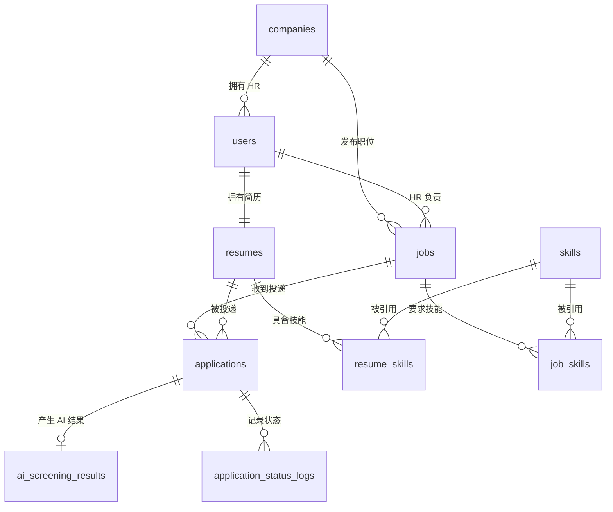

# BOSS 端数据库设计（MySQL 版）

> ⚠️ **历史稿说明**：本文是 10 表完整版设计稿，已不再作为第一阶段实施方案。  
> 第一阶段最终范围见 [BOSS端数据库第一阶段最终方案.docx](BOSS端数据库第一阶段最终方案.docx)；  
> 当前可执行 SQL 见 [sql/01_schema_mysql.sql](../sql/01_schema_mysql.sql)（5 表简单版）。

> **版本**：v1.0
> **目标数据库**：MySQL 8.0.16+（推荐 8.0.36+ / 8.4 LTS）
> **本版调整**：放弃 pgvector 与 PostgreSQL 专有设计；AI 复杂结构改用 `JSON` / `TEXT`；关系筛选全部使用 InnoDB 普通 B+ 树索引；长文本使用 MySQL `FULLTEXT` + `ngram`。
> **完整建表 SQL**：[sql/01_schema_mysql.sql](../sql/01_schema_mysql.sql)
> **说明**：本文只做数据库设计与 DDL，不包含后端代码和部署操作。

---

## 0. 结论与变更

### 0.1 最终技术选择

| 项目 | 选择 |
|---|---|
| 数据库 | MySQL 8.0.16+ |
| 存储引擎 | InnoDB |
| 字符集 | `utf8mb4` |
| 排序规则 | `utf8mb4_0900_ai_ci` |
| 主键 | `BIGINT UNSIGNED AUTO_INCREMENT` |
| 时间类型 | `DATETIME`，建议服务端 `time_zone = '+08:00'` |
| 关系索引 | InnoDB 普通 B+ 树索引 |
| 长文本检索 | `FULLTEXT` + `ngram` 倒排索引 |
| AI 复杂结果 | `JSON` / `TEXT` |
| 向量检索 | **V1 不做**；未来需要时外接向量库或单独服务 |

### 0.2 这次删掉了什么

| 删除项 | 替代方案 | 影响 |
|---|---|---|
| pgvector / 向量列 | V1 不做语义召回 | 少一个扩展依赖；未来可外接向量库 |
| PostgreSQL 部分索引 | MySQL 组合 B+ 树索引 | 队列查询用 `(status, applied_at)` 等组合索引 |
| JSONB / GIN 索引 | MySQL `JSON` + 应用层解析 | AI 结果只做展示/审计，不参与硬筛 |
| `timestamptz` | `DATETIME` + 固定时区 | 需要应用层统一时间口径 |
| PG 表达式索引 | 依赖 `utf8mb4_0900_ai_ci` 大小写不敏感 | 技能名大小写统一由排序规则处理 |

### 0.3 版本要求

- **MySQL 8.0.16+**：`CHECK` 约束才真正生效；低于这个版本会解析但忽略。
- **MySQL 8.0+**：`utf8mb4_0900_ai_ci` 可用；如果是 5.7，请改用 `utf8mb4_unicode_ci`。
- **ngram**：MySQL 8.0 内置，不需要额外安装插件；默认 `ngram_token_size = 2`。
- **不要把本脚本直接跑在 MariaDB 上**：`WITH PARSER ngram` 和部分 `CHECK` 行为可能与 MySQL 不完全一致。

### 0.4 安装建议

- Windows 安装器：[MySQL Installer for Windows](https://dev.mysql.com/downloads/installer/)
- 社区版下载：[MySQL Community Server](https://dev.mysql.com/downloads/mysql/)
- 版本选择：**MySQL 8.0.36+** 或 **8.4 LTS**，不要选 5.7。
- 安装时：
  - 端口默认 `3306`；
  - 字符集使用 `utf8mb4`；
  - 记住 root 密码；
  - 先只安装，不执行本文脚本。等确认字段后再建库。

---

## 1. 为什么 MySQL 也能承载这个项目

你的核心需求是：

1. 企业、HR、职位、简历、投递之间有明确关系；
2. 学历、经验、城市等硬条件要能快速过滤；
3. AI 结果结构复杂，但不参与硬筛；
4. JD/简历长文本要能搜；
5. 第一阶段不要引入过多基础设施。

MySQL 8.0 可以满足：

- **关系与事务**：InnoDB 支持事务、外键、唯一约束，投递状态不会写乱。
- **硬筛**：学历、经验、城市、状态都是强类型列，普通 B+ 树索引足够。
- **AI 结果**：`JSON` 存数组/对象，`TEXT` 存总结和错误信息；展示时解析，不做核心过滤。
- **长文本**：`FULLTEXT` + `ngram` 可以支持中文 JD/简历的基础检索。
- **运维**：MySQL 的托管、备份、监控、客户端都更常见，适合第一个全栈项目。

代价也要说清楚：

- MySQL 没有部分索引，队列查询要靠组合索引；
- JSON 不能像 PostgreSQL JSONB 那样灵活建 GIN 索引；
- 没有 pgvector，未来语义召回要另接服务；
- 中文全文检索的能力有限，量上来后仍然建议上 Meilisearch/Elasticsearch。

这些代价在 V1 都可以接受。

---

## 2. 十张核心表总览



| # | 表 | 作用 | 关键索引 |
|---|---|---|---|
| 1 | `companies` | 企业/租户根 | 信用代码唯一、城市、认证状态 |
| 2 | `users` | 求职者/HR/管理员账号 | 手机号唯一、邮箱唯一、企业+角色 |
| 3 | `jobs` | BOSS 端职位 | 企业+状态、筛选字段组合、FULLTEXT |
| 4 | `resumes` | 简历主表 | 用户唯一、人才库组合、FULLTEXT |
| 5 | `skills` | 标准化技能字典 | 技能名唯一、分类+状态 |
| 6 | `job_skills` | 职位要求技能 | 主键 `(job_id, skill_id)`、技能反查 |
| 7 | `resume_skills` | 简历具备技能 | 主键 `(resume_id, skill_id)`、技能反查 |
| 8 | `applications` | 投递记录 + 当前状态 | 职位+状态、求职者+状态、AI 队列 |
| 9 | `application_status_logs` | 状态变更流水 | 投递+时间 |
| 10 | `ai_screening_results` | AI 精筛结果 | 投递唯一、职位+分数、输入哈希 |

**V1 不做**：面试表、Offer 表、收藏、站内信、支付、复杂 RBAC、审计大表、向量表。

---

## 3. 关键字段说明

> 完整字段名、类型、默认值、注释见 [sql/01_schema_mysql.sql](../sql/01_schema_mysql.sql)。下面只解释设计意图。

### 3.1 `companies`：企业

关键字段：

- `id`：企业主键；
- `name` / `short_name`：全称与展示名；
- `unified_social_credit_code`：统一社会信用代码，唯一，可空；
- `city_code` / `city_name`：总部城市；
- `verification_status`：0 未认证 / 1 审核中 / 2 已认证 / 3 驳回；
- `status`：1 正常 / 0 停用。

设计要点：

- 企业不物理删除，停用用 `status`。
- B 端所有查询最终都要能通过 `company_id` 收口，避免跨企业越权。
- 发布职位前应校验 `verification_status = 2`。

### 3.2 `users`：统一账号

关键字段：

- `role`：`seeker` / `hr` / `admin`；
- `company_id`：HR 所属企业，求职者为 NULL；
- `phone` / `email`：登录与联系方式，分别唯一；
- `password_hash`：Argon2id / bcrypt 哈希；
- `status`：1 正常 / 0 禁用 / 2 注销；
- `privacy_consent_at` / `privacy_consent_version`：隐私政策同意记录。

设计要点：

- C 端和 B 端共用一个账号表，用 `role` 区分。
- V1 一个 HR 只属于一家企业；未来需要多企业时再拆 `company_members`。
- `CHECK (role <> 'hr' OR company_id IS NOT NULL)` 保证 HR 必须有企业。
- `UNIQUE (id, company_id)` 是给 `jobs` 的复合外键用的，保证“职位所属企业 = HR 所属企业”。

### 3.3 `jobs`：职位

关键字段：

- `company_id` / `hr_user_id`：所属企业与负责 HR；
- `title` / `department`：职位与部门；
- `city_code` / `city_name`：工作城市；
- `work_mode`：`onsite` / `hybrid` / `remote`；
- `salary_min` / `salary_max`：月薪，单位元，0 表示面议；
- `min_education_level`：0 不限，1 高中及以下，2 大专，3 本科，4 硕士，5 博士；
- `min_experience_months`：最低经验月数，0 不限/应届；
- `description` / `requirements`：JD 正文与要求原文；
- `status`：`draft` / `published` / `paused` / `closed`；
- `published_at` / `expires_at`：发布与过期时间。

设计要点：

- 硬条件必须是列，不能塞进 JSON；只有列才能走 B+ 树索引。
- 学历用有序数字，经验用月数，避免“3-5 年”“应届”这类文本比较。
- 复合外键 `(hr_user_id, company_id)` 防止把职位挂到别家 HR 名下。
- `FULLTEXT (title, description, requirements)` 用于职位搜索，不参与硬筛。

### 3.4 `resumes`：简历主表

关键字段：

- `user_id`：所属求职者，V1 唯一；
- `full_name` / `contact_phone` / `contact_email`：基本信息；
- `current_city_code` / `expected_city_code`：当前与期望城市；
- `accept_relocation`：是否接受异地；
- `highest_education_level`：1-5；
- `work_months`：累计工作月数；
- `current_company` / `current_title` / `desired_title`：当前与期望职位；
- `expected_salary_min` / `expected_salary_max`：期望月薪；
- `work_experience` / `self_evaluation`：长文本，AI 主要输入；
- `visibility`：`public` 进入人才库，`hidden` 仅投递可见。

设计要点：

- V1 一人一份简历，`UNIQUE (user_id)`。
- `UNIQUE (id, user_id)` 供投递表的复合外键使用，从数据库层保证“投递的简历属于该求职者”。
- `FULLTEXT (work_experience, self_evaluation)` 用于简历库关键词检索。
- 联系方式是敏感数据，B 端列表默认脱敏。

### 3.5 `skills`：技能字典

关键字段：

- `id`：`SMALLINT UNSIGNED`，技能数量不会特别大；
- `name`：展示名，如 `JavaScript`；
- `category`：编程语言/框架/数据库/中间件/工具/软技能；
- `aliases`：`JSON` 别名数组，如 `["JS", "ECMAScript"]`；
- `status`：1 启用 / 0 停用。

设计要点：

- 技能必须走字典，不能让 HR 和求职者自由输入。
- `utf8mb4_0900_ai_ci` 让 `name` 唯一索引大小写不敏感；应用层仍需 `TRIM`。
- `aliases` 只用于展示和归一化，不参与硬筛。

### 3.6 `job_skills`：职位要求技能

关键字段：

- `job_id` / `skill_id`：联合主键；
- `requirement`：`must` / `plus`；
- `weight`：AI 评分权重，0-1。

设计要点：

- `must` 是业务标签，V1 **不直接**作为 SQL 淘汰条件。
- 原因：技能是自填的，候选人可能在经历里写了 Go 但没打标签，直接硬筛会误杀。
- `must` 主要给 AI Prompt 和 HR 筛选器使用。

### 3.7 `resume_skills`：简历技能

关键字段：

- `resume_id` / `skill_id`：联合主键；
- `proficiency`：1 了解 / 2 熟悉 / 3 熟练 / 4 精通；
- `years`：使用年限；
- `source`：`self` / `ai_extracted` / `hr_confirmed`。

设计要点：

- `source` 表示可信度：自填、AI 抽取、HR 确认。
- AI 抽取结果可以作为补充，但不要覆盖用户自填数据。

### 3.8 `applications`：投递记录

关键字段：

- `job_id` / `resume_id` / `seeker_user_id`：职位、简历、求职者；
- `status`：`pending` / `screened` / `ai_processing` / `ai_completed` / `interview` / `hired` / `rejected` / `withdrawn`；
- `reject_stage`：`sql` / `ai` / `manual`；
- `reject_reason`：`education` / `experience` / `city` / `skill` / `salary` / `other`；
- `reject_note`：补充说明，C 端展示需脱敏；
- `source`：`direct` / `search` / `recommend`；
- `applied_at` / `screened_at` / `ai_started_at` / `ai_completed_at` / `hr_viewed_at`；
- `ai_attempts`：AI 尝试次数。

设计要点：

- 这是全库最热的表，不存 AI 大字段。
- `UNIQUE (job_id, resume_id)` 防止重复投递。
- 复合外键 `(resume_id, seeker_user_id)` 保证简历归属。
- V1 直接拿 `status` 当队列：
  - `pending`：初筛队列；
  - `screened`：AI 待处理队列；
  - `ai_processing`：处理中；
  - `ai_completed`：等待 HR 决策。
- `reject_stage = 'ai'` 仅表示 HR 参考 AI 结论后拒绝，不是 AI 自动拒绝。

### 3.9 `application_status_logs`：状态流水

关键字段：

- `application_id`：投递；
- `from_status` / `to_status`：原状态/新状态；
- `operator_type`：`system` / `hr` / `seeker`；
- `operator_id`：操作人，系统操作可为空；
- `reason`：原因；
- `created_at`：时间。

设计要点：

- 只追加，不更新、不删除。
- 状态变更必须“更新 `applications` + 插入日志”在同一事务完成。
- BOSS 端做审计，C 端做投递时间线。

### 3.10 `ai_screening_results`：AI 精筛结果

关键字段：

- `application_id`：唯一，V1 一个投递保留最新结果；
- `job_id` / `resume_id`：冗余，便于分析；
- `model` / `prompt_version` / `input_hash`：模型、Prompt 版本、输入哈希；
- `overall_score` / `skill_score` / `experience_score` / `project_score` / `education_score`：分数；
- `recommendation`：`strong_yes` / `yes` / `maybe` / `no`；
- `matched_skills` / `missing_skills` / `highlights` / `risks`：`JSON` 数组；
- `summary`：`TEXT`；
- `raw_response`：`JSON` 原始响应；
- `prompt_tokens` / `completion_tokens` / `total_tokens` / `cost` / `latency_ms`：成本与性能；
- `status`：`success` / `failed`；
- `error_message`：失败原因。

设计要点：

- AI 结果不写回 `applications`，避免热表被大字段拖慢。
- `raw_response` 可能含简历原文片段，限制访问并设置保留期限。
- `status = 'failed'` 时，评分和推荐字段写 NULL，不要把 0 分当成“不匹配”。
- 不同 `prompt_version` / `model` 的分数不可直接横向比较。

---

## 4. 索引策略：B+ 树为主，FULLTEXT 只做长文本

### 4.1 先区分两种索引

| 索引类型 | 用途 | 本项目的使用范围 |
|---|---|---|
| InnoDB 普通索引 / 唯一索引 | 等值、范围、排序、关联 | 学历、经验、城市、状态、外键、队列 |
| FULLTEXT + ngram | 中文长文本关键词检索 | JD、工作经历、自我评价 |

> InnoDB 的主键是聚簇 B+ 树，二级索引也是 B+ 树。  
> `FULLTEXT` 是倒排索引，不是 B+ 树；它只用于 `MATCH ... AGAINST`，不能替代学历/经验等硬筛索引。

### 4.2 核心 B+ 树索引

| 表 | 索引 | 服务的查询 |
|---|---|---|
| `applications` | `(job_id, status, applied_at)` | BOSS 端按职位筛投递、初筛批次 |
| `applications` | `(seeker_user_id, status, applied_at)` | C 端“我的投递” |
| `applications` | `(status, applied_at)` | AI 待处理队列 |
| `applications` | `(status, ai_started_at)` | AI 超时回收 |
| `resumes` | `(visibility, current_city_code, highest_education_level, work_months)` | 人才库检索 |
| `resumes` | `(visibility, updated_at)` | 人才库默认列表 |
| `jobs` | `(company_id, status, created_at)` | BOSS 端职位列表 |
| `jobs` | `(status, city_code, min_education_level, min_experience_months)` | C 端职位筛选 |
| `ai_screening_results` | `(job_id, overall_score)` | AI 精选排序 |
| `application_status_logs` | `(application_id, created_at)` | 投递时间线 |
| `skills` | `UNIQUE (name)` | 技能名唯一、归一化 |

### 4.3 没有部分索引，怎么替代

MySQL 没有 PostgreSQL 的 partial index，所以：

- 初筛队列：用 `(job_id, status, applied_at)`，`status = 'pending'` 时自然走前缀；
- AI 队列：用 `(status, applied_at)`，`status = 'screened'` 时按投递时间取；
- AI 超时回收：用 `(status, ai_started_at)`，`status = 'ai_processing'` 时按开始时间扫；
- 不要为每个状态单独建索引，否则写放大严重。

### 4.4 FULLTEXT 索引

建表脚本中已包含：

```sql
FULLTEXT KEY ft_jobs_text (title, description, requirements) WITH PARSER ngram
FULLTEXT KEY ft_resumes_text (work_experience, self_evaluation) WITH PARSER ngram
```

使用示例：

```sql
-- 职位搜索
SELECT id, title, city_name
FROM jobs
WHERE MATCH(title, description, requirements)
      AGAINST ('后端 开发' IN BOOLEAN MODE)
LIMIT 20;

-- 简历库搜索
SELECT id, full_name, current_title
FROM resumes
WHERE visibility = 'public'
  AND MATCH(work_experience, self_evaluation)
      AGAINST ('高并发 订单' IN BOOLEAN MODE)
LIMIT 20;
```

注意：

- `MATCH` 的列必须和 FULLTEXT 索引的列完全一致，否则用不上索引；
- `ngram_token_size` 默认是 2，适合中文两字词；改它需要重启并重建索引；
- 中文全文检索能力有限，量上来后接 Meilisearch/Elasticsearch；
- 不要把 `FULLTEXT` 用在学历、经验、城市这些硬条件上，仍然用 B+ 树。

---

## 5. BOSS 端初筛流程（MySQL 版）

### 5.1 为什么分两步

不要在一个 `SELECT ... FOR UPDATE` 里 JOIN 四张表。那样 InnoDB 可能连 `jobs`、`resumes` 的行一起锁，扩大锁范围。

推荐：

1. **只锁 `applications`**，抢一批待筛选 ID；
2. 再按 ID 关联读取职位/简历，计算通过或拒绝原因；
3. 批量更新状态 + 写状态流水。

### 5.2 第一步：抢一批待筛选 ID

```sql
SELECT id
FROM applications
WHERE job_id = ?
  AND status = 'pending'
ORDER BY applied_at, id
LIMIT 200
FOR UPDATE SKIP LOCKED;
```

MySQL 8.0 支持 `FOR UPDATE SKIP LOCKED`，多个 Worker 可以并行抢任务。

### 5.3 第二步：计算每条投递的初筛结果

```sql
SELECT
    a.id AS application_id,
    CASE
        WHEN r.highest_education_level < j.min_education_level THEN 'education'
        WHEN r.work_months < j.min_experience_months THEN 'experience'
        WHEN j.work_mode <> 'remote'
             AND r.expected_city_code IS NOT NULL
             AND r.expected_city_code <> j.city_code
             AND r.accept_relocation = 0 THEN 'city'
        ELSE NULL
    END AS reject_reason
FROM applications a
JOIN jobs j      ON j.id = a.job_id
JOIN companies c ON c.id = j.company_id
JOIN resumes r   ON r.id = a.resume_id
WHERE a.id IN (?, ?, ?)
  AND a.status = 'pending'
  AND j.status = 'published'
  AND c.status = 1
  AND (j.expires_at IS NULL OR j.expires_at > NOW());
```

### 5.4 第三步：批量落库

通过的：

```sql
UPDATE applications
SET status = 'screened',
    screened_at = NOW()
WHERE id IN (?, ?, ?)
  AND status = 'pending';
```

不通过的，按原因分组：

```sql
UPDATE applications
SET status = 'rejected',
    reject_stage = 'sql',
    reject_reason = ?,
    reject_note = ?,
    screened_at = NOW()
WHERE id IN (?, ?, ?)
  AND status = 'pending';
```

状态流水：

```sql
INSERT INTO application_status_logs
  (application_id, from_status, to_status, operator_type, operator_id, reason)
VALUES
  (?, 'pending', 'screened', 'system', NULL, 'SQL初筛通过'),
  (?, 'pending', 'rejected', 'system', NULL, 'SQL初筛拒绝：education');
```

要求：

- 更新状态和插入日志在同一事务；
- 不要在初筛事务里调用 AI API；
- 更新条件带 `status = 'pending'`，防止重复处理；
- 受影响行数为 0 说明被其他 Worker 抢了，直接跳过。

### 5.5 AI 队列

```sql
SELECT id
FROM applications
WHERE status = 'screened'
ORDER BY applied_at, id
LIMIT 50
FOR UPDATE SKIP LOCKED;
```

拿到 ID 后：

```sql
UPDATE applications
SET status = 'ai_processing',
    ai_started_at = NOW(),
    ai_attempts = ai_attempts + 1
WHERE id IN (?, ?, ?)
  AND status = 'screened';
```

提交事务后再调用 DeepSeek，避免长事务。

AI 成功后：

```sql
UPDATE applications
SET status = 'ai_completed',
    ai_completed_at = NOW()
WHERE id = ?
  AND status = 'ai_processing';
```

AI 失败后：

```sql
UPDATE applications
SET status = 'screened'
WHERE id = ?
  AND status = 'ai_processing';
```

并写入 `ai_screening_results.status = 'failed'`。超过 3 次转人工。

---

## 6. 投递状态机

| 状态码 | 含义 | BOSS 端 | C 端 |
|---|---|---|---|
| `pending` | 待筛选 | 待初筛 | 已投递 |
| `screened` | 初筛通过 | 待 AI / 可人工查看 | 初筛通过 |
| `ai_processing` | AI 精选中 | 评估中 | 评估中 |
| `ai_completed` | AI 精选完成 | 待 HR 决策 | 评估完成 |
| `interview` | 面试中 | 面试中 | 面试中 |
| `hired` | 已录用 | 已录用 | 已录用 |
| `rejected` | 已拒绝 | 已拒绝 | 暂不匹配 |
| `withdrawn` | 已撤回 | 已撤回 | 已撤回 |

允许的迁移：

| 当前 | 事件 | 下一状态 | 触发者 |
|---|---|---|---|
| `pending` | SQL 初筛通过 | `screened` | 系统 |
| `pending` | SQL 初筛不通过 | `rejected` | 系统 |
| `screened` | 进入 AI 队列 | `ai_processing` | 系统 |
| `ai_processing` | AI 成功 | `ai_completed` | 系统 |
| `ai_processing` | AI 失败/超时 | `screened` | 系统 |
| `screened` | HR 手动拒绝 | `rejected` | HR |
| `ai_completed` | HR 发起面试 | `interview` | HR |
| `ai_completed` | HR 直接拒绝 | `rejected` | HR |
| `interview` | 通过面试 | `hired` | HR |
| `interview` | 未通过 | `rejected` | HR |
| `pending` / `screened` / `ai_processing` / `ai_completed` / `interview` | 求职者撤回 | `withdrawn` | 求职者 |

V1 不允许：

- AI 直接把状态改成 `rejected`；
- 从 `rejected` 直接回到 `pending`；
- 从 `hired` 撤回。

---

## 7. AI 结果如何落到 JSON / TEXT

### 7.1 字段映射

| AI 输出 | 数据库字段 | 类型 | 用途 |
|---|---|---|---|
| 综合分 | `overall_score` | `DECIMAL(5,2)` | 排序、筛选 |
| 分维度分 | `skill_score` 等 | `DECIMAL(5,2)` | 展示、分析 |
| 推荐等级 | `recommendation` | `VARCHAR(16)` | 展示 |
| 匹配技能 | `matched_skills` | `JSON` | 展示证据 |
| 缺失技能 | `missing_skills` | `JSON` | 展示 |
| 亮点 | `highlights` | `JSON` | 展示 |
| 风险 | `risks` | `JSON` | 展示 |
| 总结 | `summary` | `TEXT` | HR 阅读 |
| 原始响应 | `raw_response` | `JSON` | 调试/审计 |
| Token/成本 | `prompt_tokens` 等 | `INT` / `DECIMAL` | 成本分析 |

### 7.2 示例 JSON

```json
{
  "overall_score": 86.5,
  "skill_score": 90,
  "experience_score": 85,
  "project_score": 80,
  "education_score": 75,
  "recommendation": "yes",
  "matched_skills": [
    {"name": "Go", "evidence": "5 年后端开发，主导过 Go 微服务拆分"}
  ],
  "missing_skills": ["Kubernetes"],
  "highlights": ["有高并发订单系统经验"],
  "risks": ["最近一段经历缺少量化结果"],
  "summary": "后端经验匹配度高，技术栈覆盖岗位核心要求，建议进入面试。"
}
```

### 7.3 JSON 查询示例

```sql
-- 取匹配技能
SELECT
  application_id,
  JSON_EXTRACT(matched_skills, '$[*].name') AS matched_skill_names
FROM ai_screening_results
WHERE application_id = ?;

-- 判断是否包含某个技能
SELECT application_id
FROM ai_screening_results
WHERE JSON_CONTAINS(matched_skills, '"Go"', '$[*].name');
```

注意：

- `JSON` 字段适合展示和审计，不适合做核心硬筛；
- 需要按技能筛选时，走 `resume_skills` / `job_skills` 的 B+ 树索引；
- 如果未来一定要按 JSON 内部字段过滤，增加生成列 + B+ 树索引，而不是全表 `JSON_EXTRACT`。

---

## 8. 数据治理与合规

- 城市统一用行政区划码，禁止自由文本“上海/上海市/沪”。
- 学历用 0-5 数字字典；经验用月数。
- 技能必须走字典，别名归一化：`JS` → `JavaScript`，`Golang` → `Go`。
- 手机号、邮箱、附件简历属于敏感数据，B 端列表默认脱敏。
- HR 只能看自己企业的投递；跨企业查询必须带 `company_id` 条件。
- 收集简历前要有隐私政策与授权同意；记录 `privacy_consent_at` / `privacy_consent_version`。
- 不要基于年龄、性别、婚育、民族、宗教、健康等敏感属性做筛选或评分。
- 调用第三方 AI 前尽量脱敏；`raw_response` 设置保留期限（如 90 天）。
- AI 只做评分和证据，不自动淘汰、不自动录用。

---

## 9. 执行与验收

### 9.1 执行

```bash
mysql -u root -p < sql/01_schema_mysql.sql
```

或者用客户端打开 `sql/01_schema_mysql.sql` 执行。

> 脚本会创建 `resume_screening` 数据库和 10 张表。  
> 如果库已存在，不会自动删除；需要重建时手动取消脚本顶部的 `DROP DATABASE` 注释。  
> 如果使用云数据库或当前账号没有 `CREATE DATABASE` 权限，请先手动建库，再注释掉脚本里的 `CREATE DATABASE` / `USE` 两段后执行。

### 9.2 验收清单

```sql
USE resume_screening;

SHOW TABLES;
-- 应该是 10 张

SELECT table_name, table_comment
FROM information_schema.tables
WHERE table_schema = 'resume_screening'
ORDER BY table_name;

-- 检查外键
SELECT table_name, constraint_name, referenced_table_name
FROM information_schema.key_column_usage
WHERE table_schema = 'resume_screening'
  AND referenced_table_name IS NOT NULL
ORDER BY table_name;

-- 检查全文索引
SHOW INDEX FROM jobs WHERE Index_type = 'FULLTEXT';
SHOW INDEX FROM resumes WHERE Index_type = 'FULLTEXT';
```

### 9.3 建议的初始化顺序

1. 建库建表；
2. 插入技能字典（下一步给种子数据）；
3. 注册企业 + HR；
4. 发布职位；
5. 注册求职者 + 简历；
6. 投递；
7. 跑初筛 SQL；
8. 跑 AI 队列；
9. 写入 `ai_screening_results`；
10. HR 决策。

---

## 10. 下一步

这份 DDL 已经可以直接建库。下一步建议按顺序做：

1. **技能字典种子数据**：先把 30-50 个常用技能灌入 `skills`；
2. **后端项目初始化**：NestJS / Spring Boot / Express + MySQL 驱动；
3. **初筛 Worker**：按第 5 节的两步 SQL 实现；
4. **AI Worker**：DeepSeek API + JSON 校验 + 失败重试；
5. **BOSS 端查询接口**：投递列表、人才库、AI 精选榜。

如果你要，我下一步可以继续给：

- `skills` 种子 SQL；
- 一套 BOSS 端核心查询 SQL（投递列表、人才库检索、AI 精选榜）；
- 后端表对应的 TypeORM / Prisma / MyBatis 实体。
